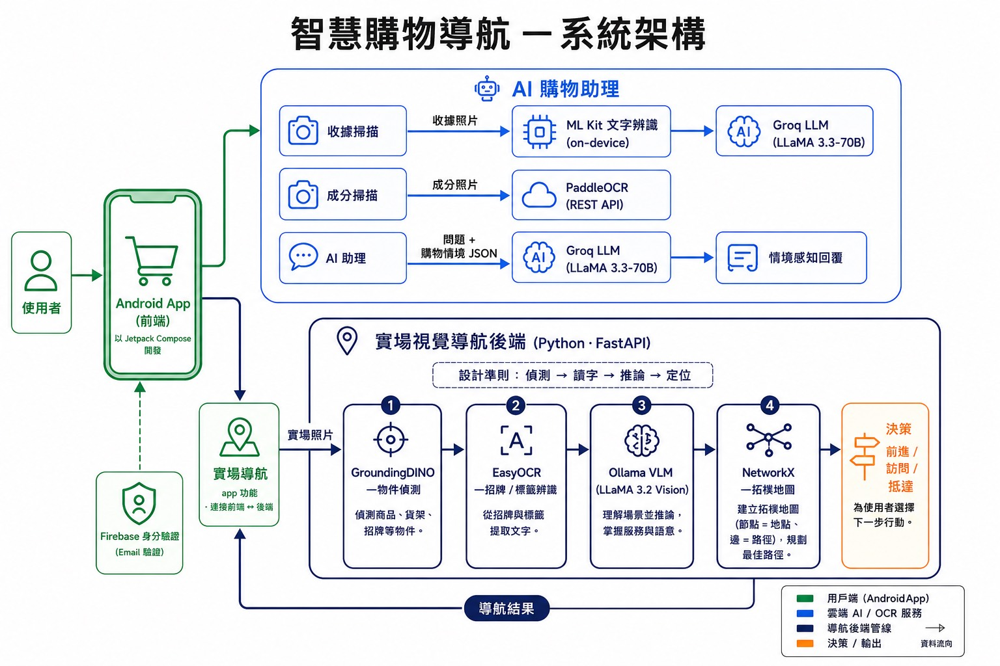
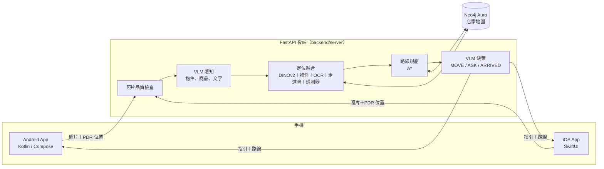

<a id="readme-top"></a>

<!-- 徽章 -->
[![Contributors][contributors-shield]][contributors-url]
[![Forks][forks-shield]][forks-url]
[![Stargazers][stars-shield]][stars-url]
[![Issues][issues-shield]][issues-url]

<!-- 專案標題 -->
<br />
<div align="center">
  <a href="https://github.com/B1229013/Shopping-Navigation">
    
  </a>

  <h3 align="center">Shopping Navigation 室內購物導航</h3>

  <p align="center">
    在賣場裡拍一張照片，就知道自己在哪、要找的商品往哪走。
    <br />
    <a href="#關於專案"><strong>閱讀說明 »</strong></a>
    <br />
    <br />
    <a href="https://drive.google.com/file/d/1nU0xep0huSmS2-fzG8ooJqlZE7_wVK6P/view?usp=sharing">開箱影片</a>
    &middot;
    <a href="https://drive.google.com/file/d/1QCjDgK6mSdlr9qOnIhToC8sy7aE-zHj6/view?usp=sharing">情境影片</a>
    &middot;
    <a href="https://github.com/B1229013/Shopping-Navigation/issues/new?labels=bug">回報問題</a>
    &middot;
    <a href="https://github.com/B1229013/Shopping-Navigation/issues/new?labels=enhancement">建議功能</a>
  </p>
</div>

<!-- 目錄 -->
<details>
  <summary>目錄</summary>
  <ol>
    <li>
      <a href="#關於專案">關於專案</a>
      <ul>
        <li><a href="#主要功能">主要功能</a></li>
        <li><a href="#使用技術">使用技術</a></li>
        <li><a href="#分支說明">分支說明</a></li>
      </ul>
    </li>
    <li>
      <a href="#開始使用">開始使用</a>
      <ul>
        <li><a href="#前置需求">前置需求</a></li>
        <li><a href="#安裝">安裝</a></li>
      </ul>
    </li>
    <li><a href="#使用方式">使用方式</a></li>
    <li><a href="#系統架構">系統架構</a></li>
    <li><a href="#測試">測試</a></li>
    <li><a href="#開發路線圖">開發路線圖</a></li>
    <li><a href="#貢獻方式">貢獻方式</a></li>
    <li><a href="#授權">授權</a></li>
    <li><a href="#聯絡方式">聯絡方式</a></li>
    <li><a href="#致謝">致謝</a></li>
  </ol>
</details>


<!-- 關於專案 -->
## 關於專案

在不熟的賣場找東西很花時間：GPS 在室內不準，店裡也很少有能用的室內地圖。
Shopping Navigation 讓使用者**只要拍照**就能導航：

1. 輸入要找的商品（例如「泡麵、牛奶」）。
2. 拍一張眼前的照片，後端用 **VLM（視覺語言模型）** 讀出照片裡的貨架、商品和標示文字。
3. 把照片和店家地圖比對，找出使用者在哪個位置、面向哪裡。
4. 在店家的走道地圖上規劃路線，回傳「直走 5 公尺後右轉」這類逐步指引。
5. 兩張照片之間，手機用 **PDR（計步＋方向）** 持續更新位置，走偏了會重新規劃。

App 另外有購物清單、預算、食材紀錄與 AI 助手等購物功能。Android 與 iOS 兩個 App 共用同一個後端。

<p align="right">(<a href="#readme-top">回到頂端</a>)</p>

### 主要功能

**導航**
* **拍照定位**：融合 **DINOv2 影像相似度 ＋ 物件名稱（中英＋語意向量）＋ OCR 文字 ＋ 走道吊牌號碼 ＋ 手機感測器位置**，
  算出使用者在哪個節點、面向哪裡（權重 DINOv2 : 物件 : OCR = 1 : 0.1 : 0.3；走道吊牌只用在 `AISLE_SIGN_PLACES` 設定的店，預設 A7）。
  在 lab1019 的 376 張測試照片上（單張照片、不帶感測器），Top-1 正確率 44.7%。
* **路線規劃**：在 Neo4j 的走道拓樸圖上用 A* 規劃；多個商品用 Held-Karp 排出最短的拜訪順序，最後帶到收銀台和出口（地圖上有標的話）。
* **逐步指引**：每張照片回傳 MOVE（繼續走）、ASK（提問）或 ARRIVED（到了）。到了要按「確認到達」；App 問「看到了嗎？」時用「有／沒有」按鈕回答。
* **PDR 即時位置**：兩張照片之間用計步與方向沿著路線前進；Android 的內建計步器沒反應時，改用加速度計自己判斷步伐。
* **照片品質檢查**：太暗、模糊、手機沒拿直（iOS）、被人或推車擋住時，會請使用者重拍；位置不確定時請使用者原地向左轉 90° 再拍一張。

**建圖與研究工具**
* **Sensor Lab**（Android）：拍照，同時錄 11 種感測器（加速度、陀螺儀、磁力、計步、旋轉向量、重力、氣壓、光線…）和 GPS，用來替新店建圖。
* **拓樸地圖建置器**（`/topomap-builder`）：把走路紀錄排成地圖；確認後用 `upload_map_v2.py` 上傳到 Neo4j。
* **定位評估**（`backend/eval/`）：單張影像定位基準、權重掃描、物件關係比較、計步檢查等，可重播已存的 VLM 結果不必重新付費。
* **監看與診斷頁**：`/dashboard`、`/tracking`、`/localize-test-page`、`/session/{id}/debug-page`。

**購物功能**
* 購物清單（自動分類）、預算、歷史紀錄、食材與營養標示辨識、AI 助手、收據掃描、附近商店（Android）。

<p align="right">(<a href="#readme-top">回到頂端</a>)</p>

### 使用技術

* [![Python][Python-badge]][Python-url] [![FastAPI][FastAPI-badge]][FastAPI-url] 後端 API
* [![Neo4j][Neo4j-badge]][Neo4j-url] 店家地圖（節點、走道、方向照片、物件、DINOv2 向量）
* [![PyTorch][PyTorch-badge]][PyTorch-url] DINOv2（`facebook/dinov2-base`）影像比對
* [![OpenAI][OpenAI-badge]][OpenAI-url] VLM 看照片、做導航決策（任何 OpenAI 相容 API；預設 `gpt-5.4-mini`，團隊透過 CGU LLM gateway 使用）
* [![Kotlin][Kotlin-badge]][Kotlin-url] [![Jetpack Compose][Compose-badge]][Compose-url] Android App
* [![Swift][Swift-badge]][Swift-url] SwiftUI、CoreMotion：iOS App

<p align="right">(<a href="#readme-top">回到頂端</a>)</p>

### 分支說明

| 分支 | 內容 |
|------|------|
| **`main`** | **後端**（`backend/`）、文件（`docs/`、`物件導向Project/`）與 PDR 航點編輯器，不含手機 App |
| **`android`** | Android App（`app/`，Kotlin）＋ 同一份後端 |
| **`ios`** | iOS App（`APPNAV_ios/`，SwiftUI）＋ 同一份後端 |
| `integrate-sensor-nav`、`docs/update-readme` | 2026-09 的舊分支，保留不動 |

三個分支的 `backend/` 完全一樣。後端的改動先做在 `android`，再同步到 `main` 和 `ios`（見[貢獻方式](#貢獻方式)）。

<p align="right">(<a href="#readme-top">回到頂端</a>)</p>


<!-- 開始使用 -->
## 開始使用

### 前置需求

| 項目 | 版本／說明 |
|------|------|
| Python | 3.11 |
| Neo4j Aura | 店家地圖存在這裡（導航必需） |
| OpenAI 相容的 API 金鑰 | VLM 與物件名稱的語意向量 |
| Android Studio ＋ JDK 17 | 只有要編譯 Android App 時（`android` 分支） |
| Xcode | 只有要編譯 iOS App 時（`ios` 分支） |

### 安裝

#### 1. 後端（每個分支都有）

1. 下載專案
   ```sh
   git clone https://github.com/B1229013/Shopping-Navigation.git
   cd Shopping-Navigation
   ```
2. 建立虛擬環境並安裝套件
   ```sh
   cd backend
   python -m venv venv
   source venv/bin/activate          # Windows：.\venv\Scripts\Activate.ps1
   pip install -r requirements-server.txt
   pip install transformers          # 伺服器端 DINOv2 定位（torch 會隨 easyocr 一起裝）；沒裝會退回只用物件＋OCR
   ```
3. 在專案根目錄建立 `.env`（可複製 `.env.example`）
   ```env
   OPENAI_API_KEY=your-key
   OPENAI_BASE_URL=https://api.openai.com/v1   # 用 CGU gateway 時改成 https://air.cgu.edu.tw/cgullmapi/v1
   OPENAI_MODEL=gpt-5.4-mini
   NEO4J_URI=neo4j+s://xxxx.databases.neo4j.io
   NEO4J_USER=neo4j
   NEO4J_PASSWORD=your-password
   VLM_PASS3=0                         # 原因見 backend/README.md
   ```
   **不要把金鑰 commit 進 git**，`.env` 已在 `.gitignore` 裡。
4. 啟動
   ```sh
   uvicorn server.server:app --host 0.0.0.0 --port 8000   # Windows 也可以用 .\start.ps1
   ```
   瀏覽器開 `http://localhost:8000/health`，看到 `{"status":"ok","neo4j":"connected"}` 就代表後端和 Neo4j 都正常；`/docs` 可看到所有 API。

#### 2. Android App（`android` 分支）

1. `git switch android`，用 Android Studio 開啟專案根目錄，連接手機後 Run。
2. 後端網址：模擬器預設 `http://10.0.2.2:8000/`；實體手機用 `adb reverse tcp:8000 tcp:8000`，
   或在 `.env` 設 `BACKEND_URL=http://<你電腦的 IP>:8000/`，也可以在 App 的設定頁切換。

#### 3. iOS App（`ios` 分支）

1. `git switch ios`，用 Xcode 開啟 `APPNAV_ios.xcodeproj`，選 iPhone 後 `Cmd+R`。
2. 後端網址：target `APPNAV_ios` → Build Settings → `NAVIGATION_BACKEND_URL`，改成你跑後端那台電腦的 IP。
3. AI 功能的 OpenAI 金鑰：在 App 的「設定」→「OpenAI API 金鑰」輸入（只存在手機上）。**不要寫進程式碼。**

<p align="right">(<a href="#readme-top">回到頂端</a>)</p>


<!-- 使用方式 -->
## 使用方式

### 導航

1. 在 App 選店、輸入要找的商品，按開始。
2. 還沒拍照前可以先告訴 App 你在哪：Android 按「我在起點，從這裡開始」，選起點後轉身面向起點照片的方向；iOS 按「我在入口，從這裡開始」。
3. 對著走道前方拍一張照片，依指引走；箭頭和小地圖會跟著你的步伐更新。
4. App 問「看到了嗎？」時按「有／沒有」；全部找到後會帶你到收銀台和出口。

### 後端 API 流程（`/session`）

| 步驟 | API |
|------|------|
| 建立導航 | `POST /session`（目標、店名）→ 後端把目標拆成要找的物件 |
| 選起點（可選） | `POST /session/{id}/start` |
| 拍照 | `POST /session/{id}/photo`（照片＋手機位置／方向）→ 照片品質 → VLM 感知 → 定位融合 → 路線 → VLM 決策 |
| 回答與確認 | `POST /session/{id}/answer`、`POST /session/{id}/confirm`（`confirmed`、手機計步判斷到達時用 `confirmed_pdr`） |
| 路線 | `GET /session/{id}/path`（小地圖與路線跟隨） |

其他 API：`GET /places`、`GET /starts`、`POST /localize`、`GET /reference-photo/{nid}.jpg?place=…`、`GET /health`。
完整清單見 `http://localhost:8000/docs`。

### 替新店建圖

1. 用 Android App 的 **Sensor Lab** 在店裡走一圈拍照（同時錄 PDR）。
2. `python build_map_v2_topomap.py`：把走路紀錄整理成建圖工作區。
3. 開 `http://<後端>/topomap-builder`：排節點、接走道、疊平面圖。
4. `python upload_map_v2.py` 上傳到 Neo4j，再跑 `rebuild_objects_v2.py`（偵測物件）和 `store_dino_v2.py`（DINOv2 向量）。

### 評估

```sh
cd backend
python -m eval.image_only --set lab1019            # 單張照片定位正確率
python -m eval.step_check <Sensor Lab 匯出資料夾>    # 走路時計步有沒有停住
```

說明與結果見 [`backend/eval/README.md`](backend/eval/README.md)。

<p align="right">(<a href="#readme-top">回到頂端</a>)</p>


<!-- 系統架構 -->
## 系統架構



| 資料夾 | 內容 |
|------|------|
| `backend/server/` | FastAPI 主程式（`server.py`）、VLM（`vlm.py`）、定位（`visual_localization.py`、`locate_fusion.py`、`loc_fusion.py`）、路線（`editor_map.py`、`path_planner.py`）、Neo4j（`neo4j_client.py`） |
| `backend/eval/` | 定位與感測器評估工具、測試資料標註、結果 |
| `backend/maps/` | 起點照片、額外走道邊、編輯器地圖 |
| `backend/legacy/` | 舊版後端與早期研究（只供研究腳本使用） |
| `app/`（`android` 分支） | Android App：`NavigationViewModel`、`MapPositionEstimator`、`PathFollower`、`PdrTracker`、Sensor Lab |
| `APPNAV_ios/`（`ios` 分支） | iOS App：`NavigationCameraView`、`MapPositionEstimator`、`PathFollower`、`MotionPathTracker` |
| `docs/` | 設計文件書、測試計劃書、期中／期末報告、架構圖 |

詳細的設定開關（`LOC_*`、`VLM_*`…）見 [`backend/README.md`](backend/README.md)。

<p align="right">(<a href="#readme-top">回到頂端</a>)</p>


<!-- 測試 -->
## 測試

```sh
# 後端（每個分支）
cd backend && python -m pytest -q

# Android（android 分支）
./gradlew :app:testDebugUnitTest

# iOS 定位邏輯（ios 分支，只要 Swift 命令列工具，不用 Xcode）
scripts/swift_logic_tests/run.sh
```

目前後端有 11 個測試在部分環境會失敗（`test_vlm.py`、`test_goal_decomposer.py`、`test_api_answer.py` 各有幾個，和設定的模型與環境有關）。

<p align="right">(<a href="#readme-top">回到頂端</a>)</p>


<!-- 開發路線圖 -->
## 開發路線圖

- [x] 拍照定位：DINOv2 ＋ 物件 ＋ OCR ＋ 走道吊牌 ＋ 感測器融合
- [x] PDR 即時位置、照片校正感測器、沿路線跟隨
- [x] Android 與 iOS 共用同一個後端（iOS 也改由後端算 DINOv2）
- [x] 多商品路線：最短拜訪順序、收銀台、出口
- [x] 物件之間的上下左右關係（實測沒有明顯變好，預設權重 0.05）
- [x] Android 內建計步器沒反應時，用加速度計補判斷步伐
- [ ] 拍照方向（指南針）輔助判斷：手機方向誤差還太大（中位數 56°），要先修好感測器方向
- [ ] 分開統計「正常角度」與「非正常角度」照片的定位正確率
- [ ] 正確、鄰近、錯誤的判斷標準與一致的測試報告

完整的問題與建議見 [open issues](https://github.com/B1229013/Shopping-Navigation/issues)。

<p align="right">(<a href="#readme-top">回到頂端</a>)</p>


<!-- 貢獻方式 -->
## 貢獻方式

1. Fork 這個專案，或在本專案開新分支
2. 建立功能分支（`git checkout -b feature/新功能`）
3. Commit 你的修改（`git commit -m '加入新功能'`）
4. Push 到分支（`git push origin feature/新功能`）
5. 開一個 Pull Request

**後端只有一份**：請在 `android`（或從 `android` 開的分支）修改後端，再同步到 `main` 和 `ios`：

```sh
git switch ios       # 或 main
git merge android
# android 的 Android 檔案有改動時會出現「deleted in ios, modified in android」衝突，刪掉即可：
git rm -r -q app build.gradle.kts gradle gradle.properties gradlew gradlew.bat settings.gradle.kts google-services.json .idea 2>/dev/null
git commit
```

iOS 前端（`APPNAV_ios/`）只在 `ios` 修改，Android 前端（`app/`）只在 `android` 修改。

<p align="right">(<a href="#readme-top">回到頂端</a>)</p>


<!-- 授權 -->
## 授權

目前沒有附上授權條款（沒有 `LICENSE` 檔案），著作權屬於專案成員。如需使用，請先聯絡我們。

<p align="right">(<a href="#readme-top">回到頂端</a>)</p>


<!-- 聯絡方式 -->
## 聯絡方式

專案成員（GitHub）：[@B1229013](https://github.com/B1229013)、[@B1229023](https://github.com/B1229023)、
[@B1222017](https://github.com/B1222017)、[@B1229020](https://github.com/B1229020)、
[@kathchen-art](https://github.com/kathchen-art)、[@selfable01](https://github.com/selfable01)

專案連結：[https://github.com/B1229013/Shopping-Navigation](https://github.com/B1229013/Shopping-Navigation)

<p align="right">(<a href="#readme-top">回到頂端</a>)</p>


<!-- 致謝 -->
## 致謝

* [DINOv2（Meta AI）](https://github.com/facebookresearch/dinov2)：影像特徵
* [Neo4j Aura](https://neo4j.com/cloud/platform/aura-graph-database/)：地圖資料庫
* [FastAPI](https://fastapi.tiangolo.com/)
* [Hugging Face Transformers](https://huggingface.co/docs/transformers)
* [Shields.io](https://shields.io/)：徽章

<p align="right">(<a href="#readme-top">回到頂端</a>)</p>


<!-- 連結 -->
[contributors-shield]: https://img.shields.io/github/contributors/B1229013/Shopping-Navigation.svg?style=for-the-badge
[contributors-url]: https://github.com/B1229013/Shopping-Navigation/graphs/contributors
[forks-shield]: https://img.shields.io/github/forks/B1229013/Shopping-Navigation.svg?style=for-the-badge
[forks-url]: https://github.com/B1229013/Shopping-Navigation/network/members
[stars-shield]: https://img.shields.io/github/stars/B1229013/Shopping-Navigation.svg?style=for-the-badge
[stars-url]: https://github.com/B1229013/Shopping-Navigation/stargazers
[issues-shield]: https://img.shields.io/github/issues/B1229013/Shopping-Navigation.svg?style=for-the-badge
[issues-url]: https://github.com/B1229013/Shopping-Navigation/issues
[Python-badge]: https://img.shields.io/badge/Python-3.11-3776AB?style=for-the-badge&logo=python&logoColor=white
[Python-url]: https://www.python.org/
[FastAPI-badge]: https://img.shields.io/badge/FastAPI-009688?style=for-the-badge&logo=fastapi&logoColor=white
[FastAPI-url]: https://fastapi.tiangolo.com/
[Neo4j-badge]: https://img.shields.io/badge/Neo4j-4581C3?style=for-the-badge&logo=neo4j&logoColor=white
[Neo4j-url]: https://neo4j.com/
[PyTorch-badge]: https://img.shields.io/badge/PyTorch-EE4C2C?style=for-the-badge&logo=pytorch&logoColor=white
[PyTorch-url]: https://pytorch.org/
[OpenAI-badge]: https://img.shields.io/badge/OpenAI_API-412991?style=for-the-badge&logo=openai&logoColor=white
[OpenAI-url]: https://platform.openai.com/
[Kotlin-badge]: https://img.shields.io/badge/Kotlin-7F52FF?style=for-the-badge&logo=kotlin&logoColor=white
[Kotlin-url]: https://kotlinlang.org/
[Compose-badge]: https://img.shields.io/badge/Jetpack_Compose-4285F4?style=for-the-badge&logo=jetpackcompose&logoColor=white
[Compose-url]: https://developer.android.com/jetpack/compose
[Swift-badge]: https://img.shields.io/badge/Swift-F05138?style=for-the-badge&logo=swift&logoColor=white
[Swift-url]: https://developer.apple.com/swift/
